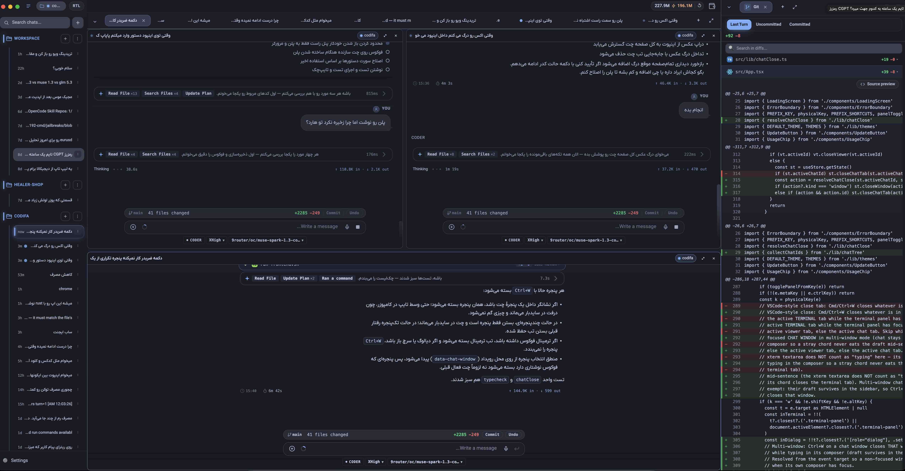

<div align="center">

# 💻 Codifa

**The offline-first AI coding assistant for your own machine.**

Codifa is a desktop IDE-style workspace — file explorer, Monaco editor and a
streaming AI chat — powered by a real **agent** that reads, searches and edits
your code _itself_, confined to the folder you choose. Bring your own model:
OpenRouter, any OpenAI-compatible API, or a fully local endpoint. Type, or just
talk. Nothing leaves your machine unless you want it to.

کدیفا یک دستیار کدنویسی دسکتاپی است؛ یک فضای کاری تمام‌عیار با کاوشگر فایل،
ویرایشگر کد و چتِ هوش مصنوعیِ زنده. در قلب آن یک **عامل واقعی** نشسته که
فایل‌های شما را خودش می‌خواند، جستجو و ویرایش می‌کند — و همه‌چیز فقط در همان
پوشه‌ای که انتخاب کرده‌اید. مدل‌تان را خودتان بیاورید: OpenRouter، هر API سازگار
با OpenAI یا یک مدل کاملاً محلی. تایپ کنید یا حرف بزنید. مگر
اینکه خودتان بخواهید، هیچ‌چیز از دستگاه شما بیرون نمی‌رود.

[English](#english-english) · [فارسی](#persian-فارسی)


[⬇️ **Download**](https://github.com/rhsaman/codifa/releases/latest) · [⭐ **Star**](https://github.com/rhsaman/codifa) · [🐛 **Report a bug**](https://github.com/rhsaman/codifa/issues/new/choose)

</div>

<p align="center">
  
</p>

---

## English / English

<details open>
<summary><b>📖 English — click for the full documentation</b></summary>

### ✨ Features

|     | Feature                             | Description                                                                                                                                                                                                                                                                                     |
| --- | ----------------------------------- | ----------------------------------------------------------------------------------------------------------------------------------------------------------------------------------------------------------------------------------------------------------------------------------------------- |
| 🔌  | **Bring your own model**            | OpenRouter, any OpenAI-compatible API, or a local endpoint (Ollama / llama.cpp / vLLM). Models are fetched live and switchable straight from the UI.                                                                                                                                            |
| 🤖  | **A real agent, not autocomplete**  | Three modes — **Ask** (read-only mentor), **Plan** (read-only planner that scouts the code and writes an implementation plan) and **Coder** (autonomous code-writing agent). Cycle with `Cmd/Ctrl+M`.                                                                                           |
| 🛠️  | **Tool-based agent**                | The agent searches and lists your files and creates or edits them by itself — confined to the folder you opened, so it never touches anything outside your project. Skills and MCP connectors you ask it to install are saved inside the app, never scattered into other tools' config folders. |
| 🎤  | **Voice input**                     | Hold the mic, speak in Persian or English, get text. Speech is sent to the speech (STT) provider you configure in **Settings → Media Providers** — pick any OpenAI-compatible endpoint that serves `/audio/transcriptions`. A live "wave" equalizer animates while recording.                                                                                       |
| 🧠  | **Memory**                          | Notes you ask the agent to remember are embedded and searchable per project — stored locally in your data folder.                                                                                                                                                                                |
| 📊  | **Live context meter**              | The context-usage bar updates in real time using the provider's exact per-request token counts, not an estimate.                                                                                                                                                                                |
| 🛟  | **Graceful small-context handling** | Works smoothly even on small 8K local models — history is compacted automatically before context runs out, so the agent keeps going instead of crashing.                                                                                                                                        |
| 🖥️  | **Full IDE UI**                     | Resizable file explorer (left), Monaco editor (center), streaming markdown chat with syntax highlighting (right), dark/light theme.                                                                                                                                                             |
| 🌐  | **RTL / LTR**                       | Persian and English mix correctly in chat — parentheses and arrows are never mirrored, and markdown (bold, headings, lists, tables) still renders properly in RTL. The whole UI and this README support both directions.                                                                        |
| 💾  | **Durable storage**                 | Settings, chat history, skills, connectors and plans are saved safely and never written inside your project.                                                                                                                                                                                    |
| 🗂️  | **RAG memory**                      | Notes you ask the agent to remember and saved web pages are embedded and searchable per project — fully offline.                                                                                                                                                                                |
| 🔁  | **Streaming + persistence**         | Token-by-token streaming replies; multiple parallel chats.                                                                                                                                                                                                                                      |
| ⌨️  | **Slash commands**                  | `/compact` (summarize into a running summary), `/clear`, `/new`, `/undo`, `/redo`, `/help`, `/skill` and `/mcp`.                                                                                                                                                                                |

### 📦 Requirements

- Node.js ≥ 20 and npm
- [Rust](https://rustup.rs/) (stable) and the Tauri prerequisites for your OS

### 📥 Installing (end users)

If you just want to run Codifa — not build it — grab the installer instead of
the source. Codifa is **not signed with an Apple Developer ID**, so macOS
quarantines the downloaded image and refuses the first launch with _"Codifa is
damaged and can't be opened"_ or _"Apple could not verify…"_. Clearing that flag
normally needs a Terminal command; the installer does it for you.

**Option A — one-command install (recommended):**

```bash
curl -fsSL https://raw.githubusercontent.com/rhsaman/codifa/main/scripts/install-macos.sh | bash
```

It downloads the latest release, verifies the app's code signature, clears the
quarantine attribute and copies the app into `/Applications`. Every step is
printed so you can read what happened. To pin a specific release, pass the tag:

```bash
curl -fsSL https://raw.githubusercontent.com/rhsaman/codifa/main/scripts/install-macos.sh | bash -s -- v1.7.0
```

**Option B — manual install:**

1. Download the `.dmg` from the [latest release](https://github.com/rhsaman/codifa/releases/latest) and drag **Codifa** into `/Applications`.
2. Clear the quarantine flag, or macOS will refuse to open it:

   ```bash
   xattr -dr com.apple.quarantine /Applications/Codifa.app
   ```

3. Open Codifa from `/Applications`. If macOS still blocks it, go to **System Settings → Privacy & Security** and click **Open Anyway**.

**Requirements:** macOS 11 or newer. The published builds are **Apple Silicon
(arm64) only** — there is no Intel macOS build, and the installer refuses to run
on one rather than install a binary the CPU cannot execute.

**Permissions:** Codifa asks for the microphone (voice dictation) and screen
recording (Computer Use). Grant them in **System Settings → Privacy & Security**;
because the app is not notarized, you may need to toggle them on and relaunch
the app once after an update.

### 🚀 Setup

```bash
npm install       # JavaScript dependencies
```

There is no backend to install: the agent, tools, MCP client, skills, document
readers and providers all run inside the Rust shell.

### 🧑‍💻 Development

```bash
npm run dev
```

Opens the Tauri window with a hot-reloading renderer. The Rust side owns the
agent loop and serves the renderer's local HTTP API (`/chat/stream`, `/skills`,
`/mcp`, `/doc/read`, …). When launched from the packaged `.app`, Codifa merges
the GUI PATH with your login-shell path so tools like `docker` (used by MCP
stdio connectors) are found.

### 🏗️ Building / packaging

```bash
npm run build       # typecheck + build renderer
npm run dist        # package for the current OS
npm run dist:mac    # only macOS (app / dmg)
npm run dist:win    # only Windows (NSIS)
npm run dist:linux  # only Linux (AppImage)
```

Output lands in `src-tauri/target/release/bundle/`.

> **macOS Gatekeeper warning:** the packaged app is ad-hoc signed (not
> notarized), so the first launch from Finder may show _"Codifa has been blocked
> because it may reduce your privacy…"_. This is expected for locally-built apps.
> Fix: right-click the app → **Open** → **Open**. If copied from a download,
> also clear the quarantine flag:
>
> ```bash
> xattr -dr com.apple.quarantine /path/to/Codifa.app
> ```
>
> Distributing to someone else? Point them at
> [`scripts/install-macos.sh`](scripts/install-macos.sh) — see
> [Installing (end users)](#-installing-end-users) — rather than embedding the
> `xattr` line in your instructions. The installer prints each step, so the
> recipient never has to read shell syntax.

### 🖱️ Usage

1. Click **Open Folder** (or `Cmd/Ctrl+O`) and select your project root.
2. Open settings (`Cmd/Ctrl+,`). Pick OpenRouter, a custom OpenAI-compatible
   API, or a local endpoint (Ollama / llama.cpp / vLLM); enter your API key /
   base URL and choose a model.
3. Choose an agent mode: **Ask**, **Plan** or **Coder**.
4. Type a message and press `Enter` (or use the mic button). The agent
   streams its reply and uses its tools to inspect or modify files — always
   confined to the folder you opened. In **Plan** mode the finished plan is saved
   for that project and auto-loaded on your next Plan/Coder run. If you ask the
   agent to install skills or MCP connectors (from a repo, a docs page, etc.),
   it saves them into the app itself — it never writes files into other tools'
   config folders, even if the source's instructions say so.

> 💡 The app **Data path** is configurable. Its default is `~/.codifa` on every
> OS: `~/.codifa` (macOS), `/home/<user>/.codifa` (Linux) and
> `C:\Users\<user>\.codifa` (Windows). Changing it moves your data to the new
> folder, keeping a backup of the old one — all from **Settings → Memory**.

### ⌨️ Keyboard shortcuts

| Shortcut              | Action                                             |
| --------------------- | -------------------------------------------------- |
| `Enter`                | Send message (`Shift+Enter` = newline)            |
| `Cmd/Ctrl+Enter`      | Queue the message (sends after the current turn, won't interrupt) |
| `Cmd/Ctrl+M`          | Cycle agent mode (Ask / Plan / Coder)              |
| `Cmd/Ctrl+P`          | Quick-open / search overlay (`⌘⇧F` = content grep) |
| `Cmd/Ctrl+B`          | Toggle sidebar                                     |
| `Cmd/Ctrl+,`          | Open settings                                      |
| `Cmd/Ctrl+S`          | Save current file                                  |
| `Cmd/Ctrl+T`          | New chat                                           |
| `Ctrl+H/J/K/L`        | Move focus vim-style between chat windows (k=up, j=down, h=left, l=right) |
| `Shift+Alt(Option)+H/J/K/L` | Swap (move) chat window positions in the same vim directions |
| `Ctrl+X` then `j`     | Toggle the terminal panel (tmux-style prefix)      |
| `Ctrl+X` then `u`     | Undo last exchange (tmux-style prefix)             |
| `Ctrl+X` then `r`     | Redo last undone exchange (tmux-style prefix)      |
| `Ctrl+X` then `c`     | Compact the chat context (tmux-style prefix)       |
| `Ctrl+X` then `v`     | Toggle the live voice session (tmux-style prefix)  |
| `Ctrl+X` then `Space` | Hold to record voice (tmux-style prefix)           |

### 🏛️ Architecture

```
┌───────────────────────────── Tauri v2 ─────────────────────────────┐
│ Rust shell (src-tauri/src)                                         │
│   agent.rs       agent loop: stream, tools, compact, steer         │
│   backend_light  the renderer's whole HTTP API (loopback)          │
│   tools.rs       fs / search / edit / terminal, sandboxed to root  │
│   skills.rs      built-in + user skills (~/.codifa/skills)         │
│   mcp.rs  lsp.rs  docs.rs  media.rs  git.rs  plans.rs  …           │
│   pty.rs         real terminal sessions                            │
│   store.rs       settings + chats, atomic writes                   │
└──────────────┬───────────────────────────────▲─────────────────────┘
               │ IPC (invoke/listen)           │ HTTP + SSE (127.0.0.1)
┌──────────────▼───────────────────────────────┴─────────────────────┐
│ Renderer (src) — React + Monaco + xterm                            │
│   chat (SSE) · file explorer · editor · terminal · viewers         │
└────────────────────────────────────────────────────────────────────┘

Providers (bring your own): OpenRouter · OpenAI-compatible · local endpoint
Data lives in ~/.codifa — settings, chats, skills, MCP, plans, traces.
```

</details>

---

## Persian / فارسی

<details>
<summary><b>📖 فارسی — برای مشاهدهٔ مستندات کامل کلیک کنید</b></summary>

<div dir="rtl">

### ✨ امکانات

|     | ویژگی                          | توضیح                                                                                                                                                                                                                                                                                        |
| --- | ------------------------------ | -------------------------------------------------------------------------------------------------------------------------------------------------------------------------------------------------------------------------------------------------------------------------------------------- |
| 🔌  | **مدل‌تان را خودتان بیاورید**  | به OpenRouter، هر API سازگار با OpenAI یا یک سرور محلی (Ollama / llama.cpp / vLLM) وصل می‌شود. فهرست مدل‌ها به‌روز گرفته می‌شود و از همان رابط کاربری قابل تعویض است.                                                                                                                        |
| 🤖  | **هدف حقیقی، نه تکمیل خودکار** | سه حالت دارد — «پرسش» (مربیِ فقط‌خواندنی)، «برنامه» (برنامه‌ریزِ فقط‌خواندنی که کد را می‌کاود و برنامهٔ پیاده‌سازی می‌نویسد) و «نویسندهٔ کد» (عاملِ خودمختاری که مستقلاً کد می‌نویسد). با `Cmd/Ctrl+M` میان‌شان بچرخید.                                                                      |
| 🛠️  | **عاملِ ابزارمحور**            | عامل خودش فایل‌ها را جستجو و فهرست می‌کند و می‌سازد یا ویرایش می‌کند — اما فقط داخل همان پوشه‌ای که باز کرده‌اید، پس هرگز به بیرون از پروژهٔ شما دست نمی‌زند. مهارت‌ها و اتصال‌های MCP را هم که بخواهید، داخل خودِ برنامه ذخیره می‌کند و در پوشه‌های پیکربندیِ ابزارهای دیگر چیزی نمی‌نویسد. |
| 🎤  | **ورودی صوتی**                 | دکمهٔ میکروفون را نگه دارید و به فارسی یا انگلیسی صحبت کنید؛ صدا به همان فراهم‌کنندهٔ گفتار (STT) که در **تنظیمات ← فراهم‌کننده‌های رسانه** پیکربندی کرده‌اید فرستاده می‌شود. هنگام ضبط، یک اکولایزر موج‌دارِ متحرک نمایش داده می‌شود.                                                                 |
| 🧠  | **حافظه**                      | یادداشت‌هایی که از عامل می‌خواهید به خاطر بسپارد، برای هر پروژه جاساز و قابل جستجو می‌شوند — به‌صورت محلی در پوشهٔ دادهٔ شما.                                                                                                                                                                  |
| 📊  | **نوار استفادهٔ بافتِ زنده**   | نوار مصرف بافت در لحظه و بر پایهٔ شمار توکنِ دقیقی که فراهم‌کننده اعلام می‌کند به‌روز می‌شود، نه برآورد.                                                                                                                                                                                     |
| 🛟  | **مدیریت هوشمند بافتِ کم**     | حتی با مدل‌های کوچک محلی (مثلاً ۸ هزار توکن) هم روان کار می‌کند — پیش از تمام‌شدن بافت، تاریخچه به‌طور خودکار فشرده می‌شود تا به‌جای توقف، کار پیش برود.                                                                                                                                     |
| 🖥️  | **رابطی به بلندِ یک IDE**      | کاوشگر فایل با اندازهٔ قابل تنظیم (چپ)، ویرایشگر Monaco (وسط) و چتِ مارک‌داون با هایلایت سینتکس (راست)، به‌همراه تم تیره و روشن.                                                                                                                                                             |
| 🌐  | **راست‌به‌چپ / چپ‌به‌راست**    | ترکیب فارسی و انگلیسی در چت درست نمایش داده می‌شود — پرانتزها و فلش‌ها برعکس نمی‌شوند و مارک‌داون (بولد، تیتر، لیست، جدول) در متن راست‌به‌چپ هم درست رندر می‌شود. رابط کاربری و همین مستندات هر دو دوزبانه‌اند.                                                                              |
| 💾  | **ذخیره‌سازی ماندگار**         | تنظیمات، تاریخچهٔ گفتگوها، مهارت‌ها، اتصال‌ها و برنامه‌ها به‌شکل امن ذخیره می‌شوند و هرگز داخل پوشهٔ پروژهٔ شما نوشته نمی‌شوند.                                                                                                                                                              |
| 🗂️  | **حافظهٔ RAG**                 | یادداشت‌هایی که از عامل می‌خواهید به خاطر بسپارد و صفحات وبِ ذخیره‌شده، برای هر پروژه جاساز و قابل جستجو می‌شوند — کاملاً آفلاین.                                                                                                                                                            |
| 🔁  | **استریم و ماندگاری**          | پاسخ‌ها قطعه‌به‌قطعه می‌رسند؛ چند گفتگوی موازی.                                                                                                                                                                                                                                              |
| ⌨️  | **دستورهای اسلش**              | `/compact` (خلاصه‌سازی گفتگو به یک خلاصهٔ جاری)، `/clear`، `/new`، `/undo`، `/redo`، `/help`، `/skill` و `/mcp`.                                                                                                                                                                             |

### 📦 پیش‌نیازها

- Node.js نسخهٔ ۲۰ به بالا و npm
- [Rust](https://rustup.rs/) (پایدار) و پیش‌نیازهای Tauri برای سیستم‌عامل شما

### 📥 نصب برای کاربران نهایی

اگر فقط می‌خواهید Codifa را اجرا کنید — نه اینکه از سورس بسازید — همان
نصب‌کننده را بردارید. Codifa با **گواهی Developer ID اپل امضا نشده است**،
بنابراین مک فایل دانلودشده را قرنطینه می‌کند و اجرای اول با پیام
_«Codifa خراب است و باز نمی‌شود»_ یا _«اپل نتوانست تأیید کند…»_ رد می‌شود. پاک
کردن آن فلگ معمولاً به دستور ترمینال نیاز دارد؛ اسکریپت نصب این کار را برای
شما انجام می‌دهد.

**راه ۱ — نصب با یک دستور (پیشنهادی):**

```bash
curl -fsSL https://raw.githubusercontent.com/rhsaman/codifa/main/scripts/install-macos.sh | bash
```

آخرین نسخه را دانلود می‌کند، امضای کد اپ را بررسی می‌کند، فلگ قرنطینه را پاک
می‌کند و اپ را در `/Applications` می‌گذارد. هر گام چاپ می‌شود تا ببینید چه
اتفاقی افتاده است. برای نصب یک نسخهٔ مشخص، تگ را بدهید:

```bash
curl -fsSL https://raw.githubusercontent.com/rhsaman/codifa/main/scripts/install-macos.sh | bash -s -- v1.7.0
```

**راه ۲ — نصب دستی:**

۱. فایل `.dmg` را از [آخرین نسخه](https://github.com/rhsaman/codifa/releases/latest) دانلود کنید و **Codifa** را به `/Applications` بکشید.
۲. فلگ قرنطینه را پاک کنید، وگرنه مک از باز کردن آن سرباز می‌زند:

   ```bash
   xattr -dr com.apple.quarantine /Applications/Codifa.app
   ```

۳. Codifa را از `/Applications` باز کنید. اگر مک باز هم مسدود کرد، به **System Settings → Privacy & Security** بروید و **Open Anyway** را بزنید.

**پیش‌نیاز:** مک‌اواس ۱۱ یا بالاتر. نسخه‌های منتشرشده **فقط اپل سیلیکون
(arm64)** هستند — نسخهٔ اینتل برای مک وجود ندارد، و اسکریپت نصب روی مک اینتل
اجرا نمی‌شود تا باینری‌ای نصب نکند که پردازنده نمی‌تواند اجرا کند.

**مجوزها:** Codifa میکروفون (دیکتهٔ صوتی) و ضبط صفحه (Computer Use) را می‌خواهد.
آن‌ها را در **System Settings → Privacy & Security** بدهید؛ چون اپ notarize
نشده است، ممکن است لازم باشد بعد از هر به‌روزرسانی آن‌ها را یک‌بار خاموش و
روشن کنید و اپ را دوباره باز کنید.

### 🚀 نصب

```bash
npm install       # نصب وابستگی‌های جاوااسکریپت
```

هیچ بک‌اندی برای نصب نیست: عامل، ابزارها، کلاینت MCP، مهارت‌ها، خوانندهٔ
سند‌ها و فراهم‌کننده‌ها همه داخل پوستهٔ Rust اجرا می‌شوند.

### 🧑‍💻 توسعه

```bash
npm run dev
```

پنجرهٔ Tauri با رابطِ گرم (hot-reload) باز می‌شود. سمت Rust حلقهٔ عامل را
در اختیار دارد و API محلیِ رابط کاربری را سرو می‌کند (`/chat/stream`،
`/skills`، `/mcp`، `/doc/read`، …). در نسخهٔ بسته‌بندی‌شده نیز PATH رابط
گرافیکی با PATH شلِ ورود ترکیب می‌شود تا ابزارهایی مانند `docker`
(موردنیاز اتصال‌های MCP) پیدا شوند.

### 🏗️ ساخت و بسته‌بندی

```bash
npm run build       # typecheck + ساخت renderer
npm run dist        # بسته‌بندی برای سیستم‌عاملِ فعلی
npm run dist:mac    # فقط مک (app / dmg)
npm run dist:win    # فقط ویندوز (NSIS)
npm run dist:linux  # فقط لینوکس (AppImage)
```

خروجی در `src-tauri/target/release/bundle/` قرار می‌گیرد.

> **هشدار Gatekeeper در مک:** نسخهٔ بسته‌بندی‌شده فقط ad-hoc امضا شده است
> (notarize نشده)، بنابراین نخستین اجرا از Finder ممکن است هشدار _«Codifa به
> خاطر کاهش حریم خصوصی مسدود شده است��_ را نشان دهد. این برای برنامه‌های
> ساخته‌شدهٔ محلی طبیعی است. راه‌حل: روی برنامه کلیک راست کنید ← **Open** ←
> **Open**. اگر از اینترنت کپی شده است، فلگ قرنطینه را هم پاک کنید:
>
> ```bash
> xattr -dr com.apple.quarantine /path/to/Codifa.app
> ```
>
> می‌خواهید برای کس دیگری بفرستید؟ او را به
> [`scripts/install-macos.sh`](scripts/install-macos.sh) ارجاع دهید — بخش
> [نصب برای کاربران نهایی](#-نصب-برای-کاربران-نهایی) — و خط `xattr` را در
> دستورهایتان نگذارید. اسکریپت نصب هر گام را چاپ می‌کند، پس گیرندهٔ کار
> نیازی به خواندن سینتکس شل ندارد.

### 🖱️ کاربرد

۱. روی **باز کردن پوشه** کلیک کنید (یا `Cmd/Ctrl+O`) و ریشهٔ پروژه را انتخاب کنید.

۲. تنظیمات را باز کنید (`Cmd/Ctrl+,`). به OpenRouter، یک API سازگار با OpenAI
یا یک سرور محلی (Ollama / llama.cpp / vLLM) وصل شوید، کلید API و آدرس پایه
را وارد کنید و مدل را برگزینید.

۳. حالتِ عامل را انتخاب کنید: **پرسش**، **برنامه** یا **نویسندهٔ کد**.

۴. پیام خود را بنویسید و `Enter` را بزنید (یا دکمهٔ میکروفون را
فشار دهید). عامل پاسخ را زنده نمایش می‌دهد و برای بررسی یا ویرایش فایل‌ها از
ابزارهایش بهره می‌گیرد — همیشه فقط در همان پوشه‌ای که باز کرده‌اید. در حالتِ
برنامه، برنامهٔ نهایی برای همان پروژه ذخیره و در اجرای بعدیِ حالت
برنامه/نویسندهٔ کد خودکار بارگذاری می‌شود. اگر از عامل بخواهید مهارت‌ها یا
اتصال‌های MCP را نصب کند (از یک مخزن، صفحهٔ مستندات و …)، آن‌ها را داخل خودِ
برنامه ذخیره می‌کند — حتی اگر دستورالعملِ منبع چنین بگوید، در پوشه‌های
پیکربندیِ ابزارهای دیگر چیزی نمی‌نویسد.

> 💡 «مسیر داده» برنامه قابل تنظیم است و پیش‌فرض آن در هر سیستم‌عاملی
> `~/.codifa` است: `~/.codifa` (مک)، `/home/<user>/.codifa` (لینوکس) و
> `C:\Users\<user>\.codifa` (ویندوز). تغییر آن، داده‌هایتان را به پوشهٔ جدید
> منتقل و از پوشهٔ قبلی پشتیبان نگه می‌دارد — همه از **تنظیمات ← حافظه**.

### ⌨️ میان‌برهای صفحه‌کلید

| میان‌بر                | کارکرد                                                |
| ---------------------- | ----------------------------------------------------- |
| `Enter`               | ارسال پیام (`Shift+Enter` = خط جدید)                |
| `Cmd/Ctrl+Enter`       | صف‌کردن پیام (بعد از پایان ترنِ فعلی ارسال می‌شود، بدون قطع) |
| `Cmd/Ctrl+M`           | چرخش میان حالت‌های عامل (پرسش / برنامه / نویسندهٔ کد) |
| `Cmd/Ctrl+P`           | جستجوی سریع و سریع‌باز کردن (`⌘⇧F` = جستجوی محتوا)    |
| `Cmd/Ctrl+B`           | نمایش/پنهان‌کردن نوار کناری                           |
| `Cmd/Ctrl+,`           | باز کردن تنظیمات                                      |
| `Cmd/Ctrl+S`           | ذخیرهٔ فایل جاری                                      |
| `Cmd/Ctrl+T`           | گفتگوی تازه                                           |
| `Ctrl+H/J/K/L`        | جابه‌جایی فوکوس میان پنجره‌های چت به سبک ویم (k=بالا، j=پایین، h=چپ، l=راست) |
| `Shift+Alt(Option)+H/J/K/L` | جابه‌جایی (سواپ) جای پنجره‌های چت در همان جهت‌های ویم |
| `Ctrl+X` و سپس `j`     | نمایش/پنهان‌کردن پنل ترمینال (پیشوندِ سبک tmux)      |
| `Ctrl+X` و سپس `u`     | بازگردانی آخرین تبادل (پیشوندِ سبک tmux)              |
| `Ctrl+X` و سپس `r`     | بازانجام آخرین تبادل بازگردانی‌شده (پیشوندِ سبک tmux) |
| `Ctrl+X` و سپس `c`     | فشرده‌سازی زمینهٔ گفتگو (پیشوندِ سبک tmux)            |
| `Ctrl+X` و سپس `v`     | نمایش/پنهان‌کردن نشست صدای زنده (پیشوندِ سبک tmux)    |
| `Ctrl+X` و سپس `Space` | نگه‌داشتن Space برای ضبط صدا (پیشوندِ سبک tmux)       |

### 🏛️ معماری

```
┌───────────────────────────── Tauri v2 ─────────────────────────────┐
│ پوستهٔ Rust (src-tauri/src)                                         │
│   agent.rs       حلقهٔ عامل: استریم، ابزارها، فشرده‌سازی، steer       │
│   backend_light  کلِ API محلیِ رابط کاربری (loopback)                │
│   tools.rs       فایل/جستجو/ویرایش/ترمینال، محدود به ریشهٔ پروژه     │
│   skills.rs      مهارت‌های داخلی + کاربری (~/.codifa/skills)          │
│   mcp.rs  lsp.rs  docs.rs  media.rs  git.rs  plans.rs  …            │
│   pty.rs         نشست‌های واقعی ترمینال                              │
│   store.rs       تنظیمات + گفتگوها، نوشتن اتمیک                      │
└──────────────┬───────────────────────────────▲─────────────────────┘
               │ IPC (invoke/listen)           │ HTTP + SSE (127.0.0.1)
┌──────────────▼───────────────────────────────┴─────────────────────┐
│ رابط کاربری (src) — React + Monaco + xterm                          │
│   چت (SSE) · کاوشگر فایل · ویرایشگر · ترمینال · نمایشگرها            │
└────────────────────────────────────────────────────────────────────┘

فراهم‌کننده‌ها (مدل خودتان): OpenRouter · سازگار با OpenAI · سرور محلی
داده‌ها در ~/.codifa است — تنظیمات، گفتگوها، مهارت‌ها، MCP، پلن‌ها، trace.
```

</div>
</details>

---

## 🤝 Contributing / مشارکت

Contributions of all kinds are welcome — bug reports, feature ideas, docs and
code. Please read [CONTRIBUTING.md](CONTRIBUTING.md) before opening an issue or
pull request.

مشارکت‌های همه‌جانبه خوش‌آمد است — گزارش باگ، ایدهٔ ویژگی، مستندات و کد. پیش از
ثبت issue یا pull request لطفاً [CONTRIBUTING.md](CONTRIBUTING.md) را بخوانید.

---

## 📄 License / مجوز

MIT — do whatever you like, just keep the license. / هر طور که می‌خواهید
استفاده کنید؛ فقط مجوز را نگه دارید.

---

⭐ If Codifa helps you, please star the repo — it helps others find it. /
اگر کدیفا به کارتان آمد، با یک ⭐ به دیده‌شدن آن کمک کنید.
